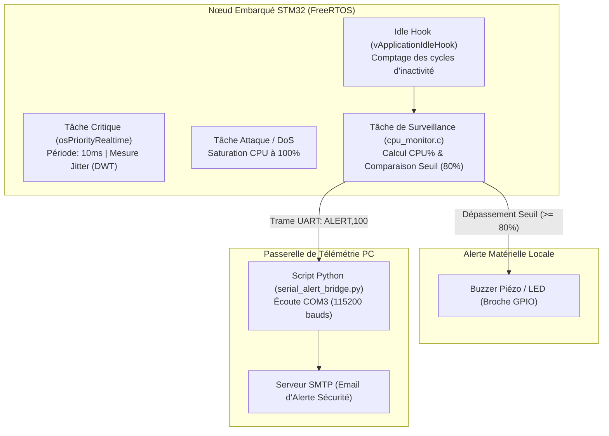

# Détection d'Anomalies et Sécurité des Systèmes Embarqués Temps Réel (STM32 + FreeRTOS)

[](https://www.st.com/)
[](https://www.freertos.org/)
[](https://www.python.org/)
[](https://www.tensorflow.org/lite)
[](LICENSE)

Projet complet d'analyse, d'expérimentation et de sécurisation d'un système embarqué temps réel sous **FreeRTOS** sur microcontrôleur **STM32**. 

Ce projet démontre l'impact des attaques par déni de service (saturation CPU) sur le respect des échéances critiques (*deadlines* et *jitter*), propose un mécanisme de surveillance par seuil d'activité avec alertes multi-niveaux (matérielle et distante), et introduit une perspective d'intelligence artificielle embarquée (**TinyML**).

---

## 📑 Table des matières
1. [Contexte et Problématique](#-contexte-et-problématique)
2. [Architecture du Système](#-architecture-du-système)
3. [Matériel et Prérequis](#-matériel-et-prérequis)
4. [Organisation du Dépôt](#-organisation-du-dépôt)
5. [Résultats Expérimentaux (PuTTY)](#-résultats-expérimentaux-putty)
6. [Workflow TinyML (Perspective)](#-workflow-tinyml-perspective)
7. [Installation et Démarrage](#-installation-et-démarrage)
8. [Support de Soutenance](#-support-de-soutenance)

---

## 🎯 Contexte et Problématique

Dans les systèmes embarqués critiques (automobile, aéronautique, médical, industrie), les tâches doivent respecter des contraintes de temps strictes. Un dépassement d'échéance (*deadline miss*) peut entraîner une défaillance catastrophique.

### Le dilemme :
* **Priorité élevée :** L'ordonnanceur préemptif du RTOS protège la tâche critique face à une attaque en priorité basse. Cependant, l'attaque reste **totalement invisible** si aucune surveillance n'est active, monopolisant les ressources résiduelles.
* **Priorité inadaptée :** Une attaque peut complètement saturer le système et provoquer des retards inacceptables (jitter supérieur à 1,9 seconde, centaines de deadlines manquées).
* **Solution :** Implémentation d'une tâche de surveillance par seuil CPU couplée à un double canal d'alerte :
  1. **Alerte locale immédiate** : Buzzer piézoélectrique / LED via GPIO.
  2. **Alerte distante** : Trame UART ➔ Script PC Python ➔ Notification par E-mail d'urgence.

---

## 🏛 Architecture du Système



---

## 🛠 Matériel et Prérequis

* **Microcontrôleur :** Carte STM32 (ex: NUCLEO-F401RE, STM32F4-Discovery, ou STM32F103 Blue Pill).
* **Connexion :** Câble USB pour alimentation, programmation (ST-LINK) et liaison série UART.
* **Composant d'alerte :** Buzzer piézoélectrique 3.3V/5V ou LED connectée sur un GPIO (ex: `PB0`).
* **Environnement logiciel :**
  * STM32CubeIDE avec FreeRTOS (CMSIS-OS).
  * Python 3.8+ (avec `pyserial`).
  * Terminal série (PuTTY ou moniteur Python intégré).

---

## 📁 Organisation du Dépôt

```text
Projet SI_2/
├── firmware/                          # Code C embarqué STM32 & FreeRTOS
│   ├── Core/
│   │   ├── Inc/
│   │   │   ├── security_tasks.h       # Définition des tâches, seuils et broches
│   │   │   └── model_data.h           # Tableau C pour TinyML
│   │   └── Src/
│   │       ├── critical_task.c        # Tâche critique & calcul du jitter DWT
│   │       ├── attack_sim.c           # Simulation d'attaque par déni de service
│   │       └── cpu_monitor.c          # Surveillance charge CPU & alerte UART/GPIO
│   └── README.md
├── pc_client/                         # Passerelle PC (Lecture Série & Alerte Email)
│   ├── serial_alert_bridge.py         # Script d'écoute COM3 et envoi d'email
│   ├── config.json.example            # Gabarit de configuration SMTP et port série
│   └── requirements.txt
├── ml_perspective/                    # Module IA / Détection d'anomalies TinyML
│   ├── train_anomaly_model.py         # Entraînement du modèle (15 features -> 1 label)
│   ├── convert_tflite.py              # Quantification int8 et export model_data.h
│   ├── dataset_sample.csv             # Échantillon de données (Consommation, CPU, RAM...)
│   └── requirements.txt
├── presentation/                      # Support d'exposé pour la soutenance
│   └── slides_content.md              # Contenu textuel complet des 10 diapositives
├── docs/                              # Documentation et ressources graphiques
│   └── README.md
├── .gitignore
└── README.md                          # Présentation principale du projet
```

---

## 📊 Résultats Expérimentaux (PuTTY)

Les essais menés sur le banc de test mettent en évidence trois comportements distincts :

| Scénario | Configuration | Comportement observé dans la console PuTTY |
| :--- | :--- | :--- |
| **1. Fonctionnement Nominal** | Aucune attaque active | `jitter_max = 0 à 24 µs`, `deadline_miss = 0`. Le système respecte parfaitement le déterminisme temps réel. |
| **2. Attaque Non Protégée** | Tâche critique en priorité basse (`osPriorityBelowNormal`) | Dégradation critique : `jitter_max = 1 999 691 µs` (~2 s), `deadline_miss = 202`. Le système est totalement bloqué. |
| **3. Protection & Surveillance** | Priorité temps réel + Moniteur seuil | L'attaque déclenche immédiatement `ALERT,100` puis `cpu=87% ALERT,87`. Le buzzer sonne et un mail est transmis. **La tâche critique conserve `jitter_max = 12 µs` et `miss = 0`**. Dès la fin de l'attaque, le CPU retombe à 1%. |

---

## 🧠 Workflow TinyML (Perspective)

Pour aller au-delà d'un simple seuil statique, une perspective d'intégration d'un réseau de neurones artificiels embarqué a été conçue :
1. **Dataset :** Basé sur 15 entrées (Puissance consommée `Power_W`, `CPU_Usage_%`, `Mem_Usage_MB`, 7 syscalls encodés, 5 processus encodés) et un label binaire (0: Normal, 1: Attaque).
2. **Entraînement :** Modèle Keras compact à 2 couches denses (`train_anomaly_model.py`).
3. **Quantification :** Compression en int8 avec TensorFlow Lite Converter (`convert_tflite.py`).
4. **Déploiement C :** Export automatique du modèle en constante `const unsigned char g_model_data[]` dans `model_data.h` pour exécution dans une tâche de surveillance FreeRTOS.

---

## 🚀 Installation et Démarrage

### 1. Démarrer la surveillance PC
```bash
cd pc_client
pip install -r requirements.txt
cp config.json.example config.json
# Renseignez vos paramètres dans config.json
python serial_alert_bridge.py
```

### 2. Flasher la carte STM32
1. Ouvrez le projet dans **STM32CubeIDE**.
2. Intégrez les sources situées dans `firmware/Core/Src` et `firmware/Core/Inc`.
3. Activez **FreeRTOS** et l'**UART2** (115200 bauds).
4. Compilez et flashez sur votre carte de développement.

---

## 🎓 Support de Soutenance

Le dossier [`presentation/slides_content.md`](presentation/slides_content.md) détaille les 10 diapositives requises pour l'exposé (Contexte, Contraintes, Menaces, Modules de sécurité, Démonstration pratique, Conclusion et Perspectives).

---

## 📄 Licence

Ce projet est sous licence MIT - voir le fichier [LICENSE](LICENSE) pour plus d'informations.
